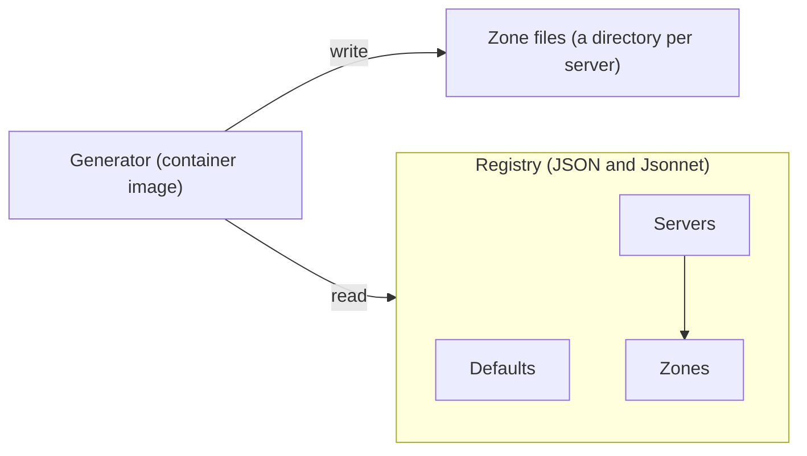

# zonegen

Keep the DNS records of your home network in one place, and generate the zone files of each DNS server from them, with the reverse zones derived from the address records.

**This project is in an early stage of development. Anything may change without notice.**

## Goals

zonegen is for the internal DNS of a home lab, served by one or more DNS servers:

- **Write each record once.** A registry holds the records of every zone, in layers that can come from different sources, such as files written by hand and files that another tool exports.
- **Derive the reverse zones.** Forward zones are easy to write by hand, but keeping PTR records in step with them is not. zonegen makes the PTR records from the A records that you pick.
- **Let each server differ where it must.** A server takes the zones as they are, and can overlay them, such as to resolve a name to another address at the edge, or to leave a zone out.
- **Keep working for years.** zonegen writes zone files in the master file format of RFC 1035, which most DNS servers read, and checks them with `named-checkzone` of BIND. It does not talk to any server.

The zone files are plain files, so you can read them, and compare them with the last ones, before you use them. They are deterministic, so they can be committed: the serial of the SOA record is whatever the registry says, and it is a fixed value unless you change it. A server that reads its zone files directly does not need the serial; secondaries that transfer zones do.

The registry is written in JSON or Jsonnet, and zonegen does not read the data of a record, other than the address of an A record. So a record can be of any type and carry anything that the master file format allows.

## Concepts



- **Registry:** the directory that defines all zones and servers.
- **Layer:** a JSON or Jsonnet file of records. The layers of a directory are merged in the order of their file names, so a later layer adds records to the earlier ones, replaces them, or removes them.
- **Zone:** a directory in `zones/`, named after the origin of the zone, such as `zones/home.arpa/`, with the layers of the zone.
- **Defaults:** the layers in `defaults/`, which lie under every zone, including the reverse zones. They suit what all zones share, such as the SOA and NS records and `$ttl`.
- **Server:** a file in `servers/` that says which zones a DNS server has, with its overlays and its reverse zones.
- **Generator:** the container image of zonegen. It renders the registry into zone files and validates them.

## Prerequisites

- Podman, or Docker.

## Getting Started

Pull the generator, and get the example registry from this repository:

```console
$ podman pull ghcr.io/t13a/zonegen
$ git clone https://github.com/t13a/zonegen.git
$ cd zonegen/example
```

Render the registry into zone files. The generator reads `registry/` of the directory mounted at `/mnt`, and writes `zonefiles/` next to it:

```console
$ podman run --rm --userns=keep-id -v .:/mnt ghcr.io/t13a/zonegen
```

`zonefiles/` then has a directory for each server of the example, `ns1` and `edge1`, with a file for each zone, such as `home.arpa.zone` and `1.168.192.in-addr.arpa.zone`. Point the DNS server at those files.

With Docker, give `--user "$(id -u):$(id -g)"` instead of `--userns=keep-id`.

## Reference

### Layers

A layer is an object of owner names, each an object of record types. A key that starts with `$` is a directive instead.

```jsonnet
// zones/home.arpa/10-base.libsonnet
{
  nas: { a: '192.168.1.10' },
  www: { cname: 'nas' },
  chat: { a: ['192.168.1.20', '192.168.1.21'] },
  '_xmpp-client._tcp': { srv: '5 0 5222 chat' },
}
```

- **Names** are relative to the origin of the zone, which is the name of its directory. `@` is the origin itself, and a name that ends with a dot is absolute.
- **Types** are written in lowercase, and the zone files have them in uppercase.
- **Data** is written as in a zone file. Names in the data are relative to the origin too, since each zone file starts with `$ORIGIN`.
- **Directives:** `$ttl` sets `$TTL` of the zone file.

A type that allows one record per name, `cname`, `dname` and `soa`, has a string. Any other type has a set of records, written in one of these ways:

| Written as | Means |
|---|---|
| `'192.168.1.10'` | one record |
| `['192.168.1.10', '192.168.1.11']` | these records |
| `{ '192.168.1.10': true, '192.168.1.11': null }` | the first record, and not the second |

null removes, at any level, what the earlier layers have there:

| Written as | Removes |
|---|---|
| `{ nas: { a: { '192.168.1.10': null } } }` | one record |
| `{ nas: { a: null } }` | the A records of `nas` |
| `{ nas: null }` | all records of `nas` |

Layers are merged object by object, and anything that is not an object, such as a string or null, replaces what was there. A file ending in `.json` suits data from another tool, and one ending in `.libsonnet` suits data written by hand, since Jsonnet allows comments, trailing commas, and keys without quotes.

The defaults must write names in the data as absolute names, such as `ns1.home.arpa.`, since they also lie under the reverse zones, whose origin is in `in-addr.arpa`.

A Jsonnet layer can read with `$` the variables that the server gives the zone, which lets a zone differ by server while it stays in one place. A variable is a hidden field, so it is not a record:

```jsonnet
// zones/home.arpa/20-app.libsonnet
local edges = { edge1: '10.0.5.20' };

{
  local edge = std.get(edges, $.SERVER),
  'app-edge': if edge == null then null else { a: edge },
  app: { cname: if edge == null then 'nas' else 'app-edge' },
}
```

Each layer sees the variables of the server, and not the other layers, so a hidden field that a layer defines is for that layer alone. zonegen does not tell variables from names, and a name that a layer writes over a variable stays hidden, so keep them apart, such as by writing variables in uppercase. The defaults do not see the variables.

### Servers

A server is a Jsonnet file that returns an object with `zones`, the zones of the server. It reads the zones of the registry from `index.libsonnet`, and changes them with the functions of `zonegen.libsonnet`:

```jsonnet
// servers/edge1.libsonnet
local i = import '../index.libsonnet';
local zonegen = import 'zonegen.libsonnet';

// The edge does not know the printer, and does not serve the lab.
local zones = zonegen.overlay(zonegen.bind(i.zones, { SERVER:: 'edge1' }), {
  'home.arpa': { printer: null },
  'lab.home.arpa': null,
});

{
  zones: zonegen.overlay(zones, zonegen.reverse(zones)),
}
```

- `zonegen.bind(zones, ctx)` gives the hidden fields of `ctx` to the layers of `zones` as variables. Bind the zones before anything merges them, such as `zonegen.reverse`, if their layers read variables.
- `zonegen.overlay(zones, over)` adds each layer of `over` on top of the zone of the same origin, and creates the zone if there is none. null removes the zone.
- `zonegen.reverse(zones)` returns an overlay with a reverse zone for each /24 of the A records in `zones`, with a PTR record for each address. To leave out a zone or a record, pass `zones` without it. An address with more than one name is an error, since a PTR record can name only one.
- `zonegen.merge(layers)` merges a list of layers, as the generator does, which helps to see what a zone holds.

`index.libsonnet` lists the files of the registry, and the generator writes it on each run. A zone in it is the list of its layers, which the generator merges only when it renders the zone, after the defaults.

### Generator

The generator renders the registry in `registry/` of the directory mounted at `/mnt` into `zonefiles/` next to it, which it creates if it is missing. It also updates `registry/index.libsonnet`. It validates the zone files that differ from the last render with `named-checkzone`, and replaces `zonefiles/` only when they are valid.

`print` evaluates `CODE`, Jsonnet code, and prints its value as JSON. It needs only the registry, and it neither validates nor writes files, which suits trying out a change. In `CODE`, `registry` is the registry, `render` the function that turns it into the zone files, and `zonegen` the functions of `zonegen.libsonnet`. `CODE` is `render(registry)` by default, which prints those files as the generator would write them.

```console
$ podman run --rm --userns=keep-id -v .:/mnt ghcr.io/t13a/zonegen print
$ podman run --rm --userns=keep-id -v .:/mnt ghcr.io/t13a/zonegen print CODE='zonegen.merge(registry.zones["lab.home.arpa"])'
$ podman run --rm --userns=keep-id -v .:/mnt ghcr.io/t13a/zonegen print CODE='zonegen.merge(zonegen.bind(registry.zones, { SERVER:: "edge1" })["home.arpa"])'
$ podman run --rm --userns=keep-id -v .:/mnt ghcr.io/t13a/zonegen print CODE='zonegen.reverse(zonegen.bind(registry.zones, { SERVER:: "ns1" }))'
$ podman run --rm --userns=keep-id -v .:/mnt ghcr.io/t13a/zonegen print CODE='render(registry)["ns1/home.arpa.zone"]' | jq -r .
```

Hidden fields are not printed, which is why `registry` shows only `servers`, but `CODE` can name one, such as `registry.zones` or `registry.defaults`. A file prints as a JSON string, which `jq -r .` turns back into the file, as in the last line.

Each release publishes the image under its version, such as `0.1.0` for the tag `v0.1.0`, and as `latest`.

A zone file has its records sorted by name, with the origin first, so that the SOA record comes first, and the NS records next. The names of a reverse zone are sorted by their numbers.
